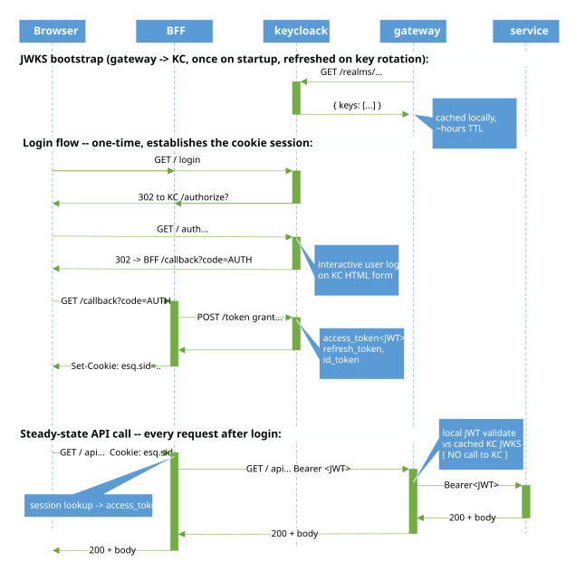
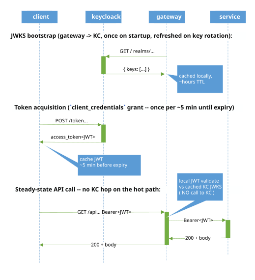
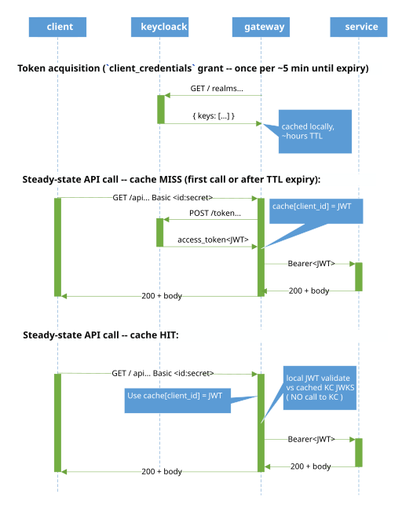
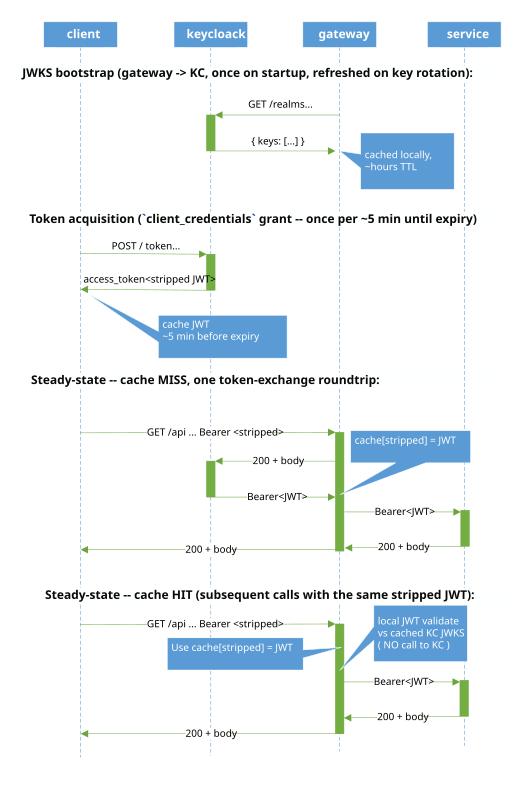

<table style="width: 100%; table-layout: fixed;">
  <tr>
    <td style="width: 12%"></td>
    <td style="width: 88%;">
       <h1>Esquire Application Frameworks(tm) 2.0</h1>
    </td>
  </tr>
</table>

# Keycloak / Gateway -- Authentication Patterns

> Part of the **[Esquire.Auth suite](Esquire.Auth.md)** -- this member records the token patterns weighed for the
> edge, and why the token Esquire uses carries the login id only. The security model is in
> [`Esquire.Auth.md`](Esquire.Auth.md).

Esquire ships one way to carry a caller to the services: the token names the user by login id, and the gateway
takes the Esquire claims -- the uid, the root path, and the roles -- from keySmith. Nothing in the token needs
hiding, because the claims are not in it.

This document is the record of how that answer was reached. Before it, a token carried the claims, and they had
to be kept from the client that held it. JWE would do that in one token, but stock Keycloak does not encrypt on
its standard `/token` endpoint. So a lab built the alternatives, ran them against the stack, and measured them:
the BFF, the JWT with claims, two token relays, and a token with the login only -- pure OAuth. The sections below
describe each pattern as it was built and measured. Two of them are what Esquire runs: the BFF in front of the
browser, and the login-id-only token. The code for the others -- the token relays and the JWE decoder -- is in git
at the `v2.0.2` tag. The conclusion at the end says why the simplest way is the one Esquire uses.

---

## Token formats -- JWT, JWS, JWE, JWK, JWKS

These five names appear together throughout this doc and are **not** synonyms:

- **JWT** (RFC 7519) -- *payload format*. A set of JSON claims (`sub`, `iss`, `exp`, plus custom claims like `esq_uid`, `esq_rootpath`, `realm_access.roles`). On its own, a JWT is just the spec for what's inside the token -- it says nothing about how the bytes are framed on the wire.
- **JWS** (RFC 7515) -- *signed wrapper* around a payload. Compact form: 3 dot-separated base64url parts -- `header.payload.signature`. The payload is readable by anyone (base64-decode the middle part); only the signer can produce a valid signature. This is what stock KC emits.
- **JWE** (RFC 7516) -- *encrypted wrapper* around a payload. Compact form: 5 dot-separated base64url parts -- `header.encrypted_key.iv.ciphertext.tag`. The payload is unreadable without the recipient's private key.
- **JWK** (RFC 7517) -- *one public key in JSON form*. Carries `kty` (key type, e.g. RSA), `kid` (key id), `use`, plus the key material itself (modulus + exponent for RSA). The signer's `kid` lands in the JWS header; the verifier uses it to pick the right JWK.
- **JWKS** (JSON Web Key Set, also RFC 7517) -- *a JSON document containing a list of JWKs*, published at a well-known URL (KC: `/realms/esquire/protocol/openid-connect/certs`). The gateway fetches this once on startup, caches it ~hours TTL, and uses it to local-validate every JWS signature without calling KC per request. This is the mechanism that keeps KC off the hot path for Patterns 1 and 2.


A JWT can be carried inside either wrapper: a JWS (signed, 3 parts) or a JWE (encrypted, 5 parts). When the industry says "JWT" casually, it almost always means *a signed JWT in JWS compact form* -- which is exactly what stock Keycloak issues. When this doc says "Bearer JWT" in the block / sequence diagrams, that's what's on the wire. In this doc, **JWS** is used only where the wrapper format itself matters -- specifically the JWS-vs-JWE comparison that motivates the "ideal" below.

## The goal

The "perfect" handshake protocol from the platform's perspective has two simultaneous properties:


Only one single-token answer meets both properties simultaneously: JWE. Every other option in the standards space trades one property for the other -- as the catalog of generic options below shows.

## The detour: JWT with claims -> Vanilla Token Relay -> Phantom Token Relay

Stock Keycloak 26 does not emit JWE on its standard `/token` endpoint for any standard grant; `DefaultTokenManager` has no encryption code path there. **Plain JWE is therefore inaccessible** until KC ships it or the platform swaps the IAS. The working answer is a detour — three patterns that incrementally hide more from the client, together approximating what a single JWE token would have given us:


Each step hides one more thing from the client. The three together form the working answer KC's missing JWE forced us into. The pattern catalog below details each option; the chosen ones are the ones along this detour.

## Options in the standards space

Every viable approach in the OAuth / OIDC / JOSE world sits on two axes: *self-contained on the hot path?* (every resource server can authorize from the token bytes alone, no per-request callback to the IAS) and *claim-hidden from the client?* (the holder of the bearer cannot read the principal's identity / scope / roles by base64-decoding it).

| Option | Self-contained on hot path? | Claim-hidden from client? |
|---|---|---|
| **Plain JWS** | Yes -- everything in the token | No |
| **JWE** | Yes -- everything still in the token, just encrypted | Yes |
| **Opaque + Introspection (RFC 7662)** | No -- gateway must call IAS per request | Yes |
| **Lightweight Access Tokens + Userinfo** | No -- token deliberately gutted, claims fetched on demand | Yes |
| **Vanilla Token Relay (HTTP Basic / mTLS at client; gateway brokers JWT via `client_credentials`)** | Yes from gateway through services; on cache HIT zero IAS roundtrips, on cache MISS one. The single stateful hop is the per-`client_id` JWT cache at the gateway | Yes (by *absence* -- client holds no token at all, only credentials) |
| **Phantom Token Relay (stripped JWT at client + RFC 8693 token-exchange at gateway)** | Yes from gateway through services; on cache HIT zero IAS roundtrips, on cache MISS one exchange call. The single stateful hop is the per-`jti` JWT cache at the gateway | Yes (claims stripped from the wire JWT; the full JWT only exists inside the cluster) |
| **BFF (browser tier only)** | Yes on gateway/service side; the cookie-session lookup is at the BFF -- one hop at the front edge, not on every microservice hop behind it | Yes (by *absence* -- browser holds no token at all) |

### The other claim-hiding options -- and why Phantom Token Relay supersedes them

Three rows in the table -- Opaque + Introspection (RFC 7662), Lightweight Access Tokens + Userinfo, and Phantom Token Relay (RFC 8693) -- share one insight: hide claims from the client and let the gateway fetch them on demand. The first two stop at "fetch on demand," and that's where the regression lives:

- **Opaque + Introspection:** client carries a random string; every resource server (gateway *and* every microservice behind it) calls `/introspect` per request to learn anything about the token. The local-validation property JWT was invented to deliver is gone -- every request pays a KC roundtrip, pre-JWT session-style.
- **Lightweight Access Tokens + Userinfo:** client carries a stripped JWT; the resource server calls `/userinfo` per request to fetch claims. Same per-request regression as introspection, *plus* a leak: `/userinfo` accepts the bearer itself, so the holder can pump it for the claims that were supposedly hidden.

**Phantom Token closes the loop.** Same wire form on the client as Lightweight, but instead of a claims-blob endpoint (`/userinfo` or `/introspect`), the gateway uses `/token grant=token-exchange` to receive a *real signed JWT* from the IAS. The gateway caches that JWT per `jti` and forwards it downstream as-is; services validate it locally against IAS JWKS, exactly as they do for a JWT with claims. The "fetch on demand" cost is borne once per token TTL at the gateway tier, not per request, and the regression doesn't propagate past the gateway. Phantom Token is the clean successor to the previous two -- it keeps their wire shape on the client side, drops their per-request cost on the resource-server side.

### Partition patterns

BFF, Vanilla Token Relay, and Phantom Token Relay are **partition patterns** -- they achieve the same outcome JWE would, but split across tiers rather than packing both properties into a single token:

- **BFF** partitions at the **browser / cluster** edge. Browser sees an opaque cookie; gateway + services see a self-contained JWS with full claims.
- **Vanilla Token Relay** partitions at the **client / gateway** edge by *removing* the bearer entirely. Client sees no token -- only credentials it needs anyway; gateway brokers a JWT via `client_credentials` and caches per `client_id`. Two trade-offs this pattern makes that the others don't:
  - **Steps outside the OAuth paradigm.** Credentials are presented to (and verified at) the gateway, not directly to the IAS. The gateway proxies the auth one hop, but operationally the credentials live at a place other than the canonical authentication authority -- the OAuth assumption that the client authenticates to the IAS and presents a bearer to resource servers is broken on purpose.
  - **No SSO.** Each gateway authenticates the client independently; the client re-presents credentials to every gateway it talks to. The "single sign-on" property -- one IAS session works across many resource servers -- is gone, because there's no IAS-issued bearer on the client side to carry.
- **Phantom Token Relay** partitions at the **client / gateway** edge by *stripping* the bearer. Client sees a JWT whose payload has been emptied (a *phantom token*); gateway restores via RFC 8693 token-exchange and caches per `jti`.

All three keep the property that matters most for performance -- KC off the hot path through the microservices behind the gateway -- and absorb the cost of claim-hiding at one well-defined seam.

## Token Relay -- the umbrella shared by Vanilla Token Relay and Phantom Token Relay

Vanilla Token Relay and Phantom Token Relay are both **Token Relay** patterns. The gateway acts as an OAuth 2.0 client on behalf of downstream services: it ingests an edge credential from the inbound request, resolves or exchanges it for a JWT, caches the result, and relays the JWT down the service chain. Downstream services don't authenticate against KC themselves; they validate the gateway-relayed JWT locally against cached JWKS -- the same mechanism the JWT with claims uses. The two patterns differ only in **what the edge credential is**:

- **Vanilla Token Relay:** edge credential = static OAuth client credentials (HTTP Basic, or mTLS in the strongest form). Gateway runs the `client_credentials` grant against KC to obtain the JWT.
- **Phantom Token Relay:** edge credential = a *phantom token* (a stripped JWT whose payload has been emptied). Gateway runs RFC 8693 token-exchange to restore the full claim-rich JWT.

The two share workflow, cache shape, and downstream behaviour; they differ in four points -- edge credential extraction, cache key derivation, KC grant form, and which client opt-in env they consult. Per-pattern details follow below.

## The seam a new pattern arrives on -- and what tests it

A pattern is not built into the gateway; it is an `ITokenRelayVariant` the gate is handed. The variant reads the
inbound request and answers one of three things -- `Pass` (not mine), `Reject` (mine, and refused), `Relay`
(mine: here is the cache key and the token request to make). Everything after that is shared: `TokenRelayFilter`
carries the decision out, `TokenRelayCache` keys the result, and `ITokenRelayClient` makes the call. So another
pattern -- another grant, or another identity service -- is one new variant and one line where the variants are
assembled, in `gateway/.../config/SecurityConfig.java`.

**Where it is configured.** The gate's own identity connection is `keycloak.exchange` -- endpoint, realm,
credentials and the two timeouts, the same six keys kcMaster configures its admin client with (see
`services.configuring.md`, "KeyCloak connection"). Pointing the gate at a different service is that block; the
variant's allowlist stays with the variant. A variant that is allowlisted while that block is not set stops the
gate at start-up rather than refusing its callers one request at a time -- so a half-finished experiment says so
in the first line of the log.

**What tests it.**

| level | where | what it proves |
|---|---|---|
| the gate refuses to start half-able | `TokenRelayWiringGuardTest` | an allowlist with no endpoint, no realm or no exchange client stops the gate at start-up; an empty allowlist is the off switch and starts fine |
| the rules every variant keeps | `TokenRelayVariantContractTest` | an anonymous request is passed, an unhandled scheme is passed, and a caller outside the allowlist is never relayed -- run over every variant there is |
| what one variant decides | `VanillaTokenRelayTest`, `PhantomTokenRelayTest` | the edge credential it accepts, the cache key it chooses, the grant form it builds, and what it refuses |
| what the gate does with the decision | `TokenRelayFilterTest` | first decision wins, a refusal is 401 with the chain never run, a relay hands the chain the brokered Bearer and not the caller's own credential |
| what a hit saves | `TokenRelayCacheTest` | miss then hit, expiry re-acquires, keys stay apart |
| end to end, on a running stack | `e2e-test/tests/20-token-relay.spec.ts` | the whole path, calling the gate DIRECTLY -- through the BFF proxy the relay is never reached |

A new variant added to `TokenRelayVariantContractTest.variants()` gets the first row for free.

The e2e spec takes its gate, its identity endpoint and both client credentials from the environment
(`GATEWAY_URL`, `KC_URL`, `KC_REALM`, `RELAY_VANILLA_CLIENT` / `_SECRET`, `RELAY_PHANTOM_CLIENT` / `_SECRET`),
so the same two tests run against another service without an edit. `RELAY_DISABLED=true` skips them, which is
what the cloud run does -- the internet-facing gate ships empty allowlists by design.

## Caches in play

"KC off the hot path" is bought with caching, not by being stateless. Three caches participate; none are per-request:

| Cache | Used by | Key | Value | Where | TTL |
|---|---|---|---|---|---|
| **JWKS** | all patterns | KC realm | KC public keys | gateway + every service | Nimbus default (minutes; refresh-ahead on miss) |
| **Vanilla Token Relay JWT** | Vanilla Token Relay | `client_id` | full JWT | gateway only | until JWT `exp` |
| **Phantom Token Relay JWT** | Phantom Token Relay | source-token `jti` | full JWT | gateway only | until JWT `exp` |
| **Pure OAuth claims** | pure OAuth (lab) | login id | uid, root path, roles | gateway only, one per replica | while asked for; idle after `cache-idle-ms`, or removed by an eviction |

JWKS is shared signature-validation infrastructure used by every microservice on every request -- without it none of the patterns would be hot-path-local. The Vanilla Token Relay and Phantom Token Relay JWT caches are gateway-tier state, pattern-specific; they absorb the per-request KC roundtrip that would otherwise happen on every call. Downstream of the gateway, only the JWKS cache exists -- services see plain Bearer JWTs and validate locally.

## What Keycloak allowed

The generic options above assume an IAS that cleanly implements the relevant standards. Stock Keycloak 26.6.0 doesn't, in two specific ways:

- **No JWE on `/token`.** KC's `DefaultTokenManager` has no encryption branch on `/token` for any standard grant; the relevant client attribute (`access.token.encrypted.response.alg=RSA-OAEP`) is silently ignored. JWE on the wire is therefore unavailable until KC ships it or the platform swaps to an IAS that does (Auth0, Okta, ForgeRock, Ping all do). The "ideal" single-token option is out.
- **RFC 8693 token-exchange cannot mint for an audience client.** The gateway can't ask the exchange to mint a token *for a specific downstream (audience) client*, so that client's claim mappers never run on the exchanged token -- which is exactly the cleanest Phantom Token form. Token exchange is not an admin permission under FGAP:v2 and will not become one, so the permission that would allow it cannot be granted. The mechanics:


> **Why the audience form is unavailable.** Token exchange runs as v1, a deprecated preview that requires
> FGAP:v1. **FGAP:v2 does not carry token-exchange permissions and will not** -- Keycloak's position is that
> token exchange is conceptually not an admin permission. The permission that would let the gateway mint for a
> downstream client therefore cannot be granted: enabling fine-grained permissions on that client answers
> `501 Feature not enabled`, and the exchange itself refuses with `403 client not allowed to exchange to
> audience`.
>
> **The route forward is token-exchange v2**, not keeping v1 alive. The v1-capabilities-missing-from-v2 gap is
> tracked in [#43151](https://github.com/keycloak/keycloak/issues/43151) and
> [#39686](https://github.com/keycloak/keycloak/issues/39686) -- both worth watching, and both a reasonable
> place to contribute this deployment's use case as a data point.

The lab built all four -- **BFF + JWT with claims + Vanilla Token Relay + Phantom Token Relay** -- and duplicated the claim mappers on the exchange client to work around the audience gap. The two relays were the exploration of the JWE detour. They never ran on the public OKE API: their gateway allowlists were empty there. Their code is in git at the `v2.0.2` tag.

### Phantom Token Relay -- what it delivers

Verified 2026-08-20 on the docker stack, brought up from scratch with the realm imported
from `keycloak/import/esquire.json`. The client is `esq-hauberk-M`, the exchange client `esq-gw-exchange`.

**The pattern delivers what it promises.**

| checked | result |
|---|---|
| the client's bearer carries no readable claims | `esq_uid`, `esq_rootpath` and `realm_access` absent -- 9 claims, against 11 in a full token |
| `/userinfo` cannot be pumped for them | returns `sub` alone |
| the request still reaches a protected route | stripped bearer -> gateway -> HTTP 200 with data |
| services receive the claims | the exchanged token carries `esq_uid`, `esq_rootpath` and the role set |

**The `/userinfo` result is the one that matters.** Lightweight Access Tokens are rejected above because
`/userinfo` accepts the bearer and hands back the claims that were supposed to be hidden. Phantom Token Relay
does not inherit that: the endpoint is scope-driven and stays stripped, so a holder of the wire token learns
nothing from it and nothing from Keycloak.

`client.use.lightweight.access.token.enabled` is **true** on the phantom clients, so claim-hidden at the
client is a property the pattern actually carries.

### Why the claim mappers are duplicated on the exchange client

The exchange cannot mint **for a downstream (audience) client**, so that client's own mappers never run. The
claim mappers (`esq_uid`, `esq_rootpath`, `realm_access.roles`) are therefore **duplicated on the
`esq-gw-exchange` requesting client**, and the exchange runs without `audience=`; Keycloak mints for the
requesting client and the duplicated mappers put the principal's claims on the exchanged token. Downstream
services validated it as they did a JWT with claims.

An `audience=` exchange is refused:

```
403  error="access_denied"  "Client not allowed to exchange"
     TOKEN_EXCHANGE_ERROR  reason="client not allowed to exchange to audience"
```

The permission that would allow it cannot be granted: enabling fine-grained permissions on the audience
client answers **`501 Feature not enabled`**. That is the documented position made concrete -- token exchange
is not an admin permission in FGAP:v2 and will not become one, so the audience form has no route on this
platform. **The mapper duplication is structural, not a temporary patch**, until the gateway moves to
token-exchange v2.

The exchange runs on **v1**, which Keycloak reports at boot as
`Preview features enabled: token-exchange:v1` and `Deprecated features enabled: token-exchange:v1`.

### Can Phantom Token Relay stand in for JWE?

**For the claim-hiding half, yes.** JWE would have carried claim-hidden and locally-validated in one token;
Phantom Token Relay partitions those two across the client/gateway seam and, as verified above, delivers
both -- the client sees nothing, services validate locally against JWKS.

What it costs:

- **~6 ms per request on a cache HIT** against ~1 ms for a JWT with claims, plus ~11-16 ms on MISS
- **a stateful per-`jti` cache** at the gateway -- the one stateful hop in the design
- **a deprecated foundation** -- v1 exchange, and the audience form permanently unavailable

So it is a working demonstration of the pattern and a genuine claim-hiding option, not a reason to move BFF
or the JWT with claims off the path they were on then. The conclusion at the end of this document says where
the evaluation came out.

## Implementation -- the four patterns, and pure OAuth

### BFF -- token hidden from the browser

Use case: browser-based clients (the Angular SPA via `explorer/backend/`). The browser never sees the JWT; the BFF tier holds it server-side and proxies API calls.

```
   BFF holds JWT in server-side session store (Redis / in-memory);
   browser never sees the JWT. Solid arrows = per-request hot path;
   downward arrows (1)(2)(3) = one-time / bootstrap interactions.
```
- **Claim-hidden:** yes (by absence -- there's no token on the browser tier)
- **Self-contained on hot path:** yes from gateway onwards (gateway + services do local JWT validation against KC's JWKS)
- **Cost:** one extra tier (BFF) + session-store sizing + cookie/CSRF semantics
- **Where it runs:** `explorer/backend/src/auth/` (the BFF: the login, the session store, the token refresh) and the `esq-angular` client in `services/keycloak/import/esquire.json` (auth-code + PKCE). The BFF adds the session's token to every `/api/*` call; the gateway takes it as any bearer.



### JWT with claims -- client holds the JWT, gateway validates locally

Use case: non-browser clients that can be trusted to carry a JWT (service-to-service callers, future mobile or API consumers when claim-visibility is acceptable).

```
   Gateway local-validates JWT against cached KC JWKS — NO KC roundtrip
   per request. Solid horizontal arrows = per-request hot path;
   downward arrows (1)(2) = bootstrap / token refresh.
```

- **Claim-hidden:** no (anyone with the JWT can base64-decode and read claims)
- **Self-contained on hot path:** yes (gateway + services local-validate; KC JWKS cached)
- **Cost:** lowest -- nothing extra; the standard OAuth2 / OIDC bearer flow
- **Where it was built:** the Esquire claim mappers (`esq_uid`, `esq_rootpath`, `realm_access.roles`) on the `esq-angular` and `esq-hauberk` clients. It was the default until v2.0.3, which removed the mappers; both clients now issue the login-id-only token (pure OAuth).



### Vanilla Token Relay -- static client credentials at the edge

Use case: non-browser clients that need **maximum claim-hiding and bearer-replay protection** without a BFF tier -- service-to-service callers, high-trust automation, principals performing high-value or financial actions. **The client holds no token of any kind**, not even a claim-less one. The client presents credentials per request (HTTP Basic over TLS, or mTLS); the gateway authenticates the client, brokers a JWT with KC on the client's behalf via the `client_credentials` grant, caches the JWT per `client_id`, and forwards a full JWT to internal services. Services do the same local JWT validation as for plain JWT -- they never see anything different.

```
   Client side: ZERO bearer tokens. Just credentials the client needs
   anyway. Gateway brokers all token interactions with KC and caches the
   JWT per client_id (TTL = JWT exp minus 30s buffer). Hot path is zero
   KC roundtrips after first cache fill.
```

- **Claim-hidden:** **yes, absolutely** -- the client never holds a token; if an attacker exfiltrates the credentials, they must be replayed against the gateway, where they can be IP-restricted, rate-limited, or hardened with mTLS. A stolen bearer JWT, by contrast, is accepted by any resource server that trusts the issuer -- there is no single chokepoint where network-layer controls can be applied.
- **Bearer-replay risk at client/gateway edge:** **eliminated** -- credentials are not bearer tokens; only the gateway-service hop carries bearers, and that traffic stays inside the cluster
- **Self-contained on hot path:** yes, after first cache fill. First request pays one KC roundtrip (~3 ms); subsequent requests within JWT TTL hit gateway cache and pay zero
- **Revocation visibility:** bounded by cache TTL (default ~5 min). For faster revocation, shorten cache TTL; for immediate revocation, invalidate cache on KC admin events
- **Cost:** +3 ms p50 on cache MISS (one `client_credentials` grant); zero on cache HIT; cache memory ~1 KB per active client_id; +1 KC roundtrip per ~5 min per client_id (not per request)
- **Where it was built:** the `VanillaTokenRelay` variant under a shared `TokenRelayFilter` + `TokenRelayCache` + `WebClientTokenRelayClient` seam in the gateway, armed per client by `ESQ_GW_VANILLA_CLIENTS`. The code is in git at the `v2.0.2` tag.
- **Inbound-Bearer enforcement:** `VanillaTokenRelay.examine()` also inspects inbound `Authorization: Bearer` requests. `JwtClaimPeek.peekAzp()` extracts the `azp` claim **without signature check**; if the value is in this variant's allowlist, the variant returns `VariantAction.Reject("Bearer JWT with azp=[X] is in Vanilla Token Relay allowlist -- must use HTTP Basic")` and `TokenRelayFilter` short-circuits the chain with **401**. This closes an architectural bypass: a misconfigured or compromised client could otherwise call KC's `/token` endpoint directly and present the resulting JWT as Bearer to skip the no-token-on-client property. The peek's role is catching *honest misconfigurations* with a clear error; a *forged* token (lying `azp` that escapes the allowlist match) would still fail JWS signature validation one step later at the service tier -- so the unauthenticated peek costs nothing on the attack path.



**mTLS variant (strongest form):** replace HTTP Basic with mutual TLS. Client presents a certificate during the TLS handshake; gateway maps the cert's subject (or SAN) to a configured `client_id` and looks up a server-held secret to perform the `client_credentials` grant. The wire then carries **neither bearer token nor shared-secret credential** -- only the client's **public certificate** is exposed during the handshake; the matching private key never leaves the client. All other components (cache, KC call, forward) are identical. Operational cost: cert lifecycle management on the client side.

**Threat-model contrast vs JWT with claims:** a stolen bearer with claims grants the attacker the user's full identity (claims base64-readable) until natural expiry. In Vanilla Token Relay, there is no bearer to steal at the client side -- only credentials, which the gateway can additionally protect with IP allowlists, rate limits, or mTLS. The full JWT exists only between gateway and service, never crosses the cluster boundary.

> **Anti-pattern note: Credential Over-Exposure.** Sending the client secret on every request -- even over TLS -- is classified in formal OAuth 2.0 security reviews as *Credential Over-Exposure*. Standard OAuth practice uses the secret once to obtain a token and then carries only the token; this pattern accepts that regression to get *no bearer at the client* in exchange. The mTLS variant above removes the regression entirely (no shared secret on the wire). For HTTP Basic deployments, mitigations are TLS-only transport, IP allowlists or rate limits at the gateway, and short cache TTLs to bound the blast radius of any leaked credential.

### Phantom Token Relay -- stripped JWT on client, gateway restores via RFC 8693

Use case: non-browser clients that need claim-hiding **and** the standard OAuth bearer-flow shape -- service-to-service callers that get a token from KC once and present it to multiple gateways/services, with claims invisible to the holder. Same anti-leakage property as Vanilla Token Relay, but the client carries a bearer (stripped of claims) instead of credentials. This restores the **token portability** property Vanilla Token Relay gives up (one token works across multiple cluster-edges), at the cost of a per-`jti` gateway-to-KC roundtrip on cache MISS and a stealable (if claim-empty) bearer at the client.

```
   Client side: bearer is a real JWT but its payload is stripped --
   no esq_uid, no rootpath, no roles. Decoding it tells the holder
   nothing useful about the principal. /userinfo also returns nothing
   useful by virtue of the esq-lightweight scope. The full JWT exists
   ONLY between gateway and service; gateway caches per jti so the KC
   roundtrip is amortized across the stripped token's lifetime.
```

- **Claim-hidden:** **yes** -- client's wire token has no readable claims; the full JWT materializes only after the gateway exchange. `/userinfo` is also stripped (scope-driven), so the client cannot pump it for claims.
- **Self-contained on hot path:** partial -- gateway-to-KC token-exchange is per-`jti` (cache HIT skips KC); gateway-to-service-to-service is fully self-contained (local JWT validation against cached KC JWKS).
- **Token portability / service SSO:** **yes** -- one stripped JWT works against multiple gateways that all share the same `esq-gw-exchange` permission grant. Vanilla Token Relay clients have to re-authenticate to each gateway; Phantom clients don't.
- **Bearer-replay risk at client edge:** yes -- the stripped JWT is a stealable bearer; an attacker with it has the same gateway access as the legitimate client until natural expiry. Mitigated by claim-hiding -- the stolen token reveals nothing -- and by short TTLs.
- **Revocation visibility:** bounded by gateway cache TTL (same as Vanilla Token Relay).
- **Cost:** +5-15 ms p50 on cache MISS (token-exchange roundtrip); zero on cache HIT; cache memory ~1 KB per active `jti`; +1 KC roundtrip per token TTL per active `jti`.
- **Where it was built:** the `PhantomTokenRelay` variant under the same seam; the gateway authenticated to Keycloak's token exchange as the `esq-gw-exchange` client, armed per client by `ESQ_GW_PHANTOM_CLIENTS`. The code is in git at the `v2.0.2` tag.
  
**Vanilla Token Relay vs Phantom Token Relay -- when to pick which:**

| | Vanilla Token Relay | Phantom Token Relay |
|---|---|---|
| Client holds | nothing token-shaped -- only credentials | a stripped JWT (bearer) |
| Cache key at gateway | `client_id` | `jti` (per-token) |
| One token across multiple gateways | NO -- per-gateway credential auth | YES -- portable bearer |
| Bearer-replay risk at client edge | none (no bearer) | yes (stripped JWT is stealable) |
| Client must support | HTTP Basic over TLS (or mTLS) | standard OAuth Bearer flow |
| KC config burden | one allowlist on gateway | client + scope + token-exchange permission |
| KC roundtrip frequency | ~1 per `client_id` per 5 min | ~1 per `jti` per 5 min |

Vanilla Token Relay is the strongest claim-hiding for clients that can present credentials per request. Phantom Token Relay keeps the standard OAuth client shape and adds token portability across multiple gateways, accepting the bearer-replay surface as the cost.

#### What the client actually receives (when `lightweight.access.token.enabled=true`)

The client's bearer is a real, signed JWT (3 parts, `header.payload.signature`), valid for downstream JWS verification. Only the **payload** is stripped. Every KC framework-level claim still has to be present so the token validates as OIDC:

```json
{
  "iss":   "https://esquire.mir0n.pro/kc-auth/realms/esquire",
  "iat":   1778797924,
  "exp":   1778798224,
  "jti":   "trrtcc:8e4b5b...",         // unique token id (cache key on gateway)
  "sub":   "b28d5f6e-3a99-4c1d-...",   // KC user UUID (service-account-<phantom-client>)
  "typ":   "Bearer",
  "azp":   "<phantom-client>",         // authorized party
  "scope": "<lightweight-scope>",
  "aud":   "<exchange-client>"         // audience mapper output -- required for the gateway to call token-exchange
}
```

Business claims (`esq_uid`, `esq_rootpath`, `realm_access.roles`) are configured per-mapper via the `lightweight.claim` attribute:

- `lightweight.claim=true`  -> claim IS included in lightweight access tokens
- `lightweight.claim=false` -> claim is OMITTED from lightweight access tokens (this is what we want for stripping)

So a stripped token tells the holder: "you're authenticated, here's a token id, this is the client and KC realm, here's when it expires" -- nothing about the principal's Esquire-side identity, permission scope, or roles. The decoder learns operational metadata, not business identity. Payload size is ~150 bytes vs ~400 bytes for a full token.

**Current deployment state:** `client.use.lightweight.access.token.enabled=true` on the Phantom Token Relay clients, so the wire token really is stripped. The exchanged token carries the principal's claims because the mappers are duplicated on the `esq-gw-exchange` requesting client -- see [Why the claim mappers are duplicated on the exchange client](#why-the-claim-mappers-are-duplicated-on-the-exchange-client).

### Pure OAuth -- the token carries the login only

Use case: a client whose token says who the user is, and nothing more. The Esquire claims (`esq_uid`,
`esq_rootpath`, the roles) stay in Esq2025, and the gateway puts them on the request. It began as a lab mode
beside the claims-carrying token, and it is now the only way Esquire runs, on both lines: the BFF's client
(`esq-angular`) and the load harness's client (`esq-hauberk`) issue tokens with the login only.

A request, step by step:

1. Keycloak issues the pure client's access token with `sub` and `preferred_username`. No Esquire claim
   mapper runs, and the client has no `roles` scope. The username is the Esq2025 login id, in lower case
   on both sides.
2. The gateway validates the signature and the expiry against the cached JWKS, as for any signed JWT.
   `EsqClaimsValidator` requires `sub` and `preferred_username`.
3. The gateway finds the claims in its own cache by the login id. On a miss it asks keySmith,
   `GET /esq-claims?loginId=`, which reads the access profile and its roles from Esq2025. No gateway route
   exposes that endpoint.
4. The gateway authorizes the route by those roles. It removes any inbound `X-Esq-UID`, `X-Esq-Root-Path`
   and `X-Esq-Roles` headers, for every caller, and sets its own. On the bus path it puts the same values
   into the command body.
5. The services behind the gateway read the claims from those headers when the token carries no
   `esq_uid`: the `common` filter, and gateWard in the compact shape.

**How a change reaches a signed-in user.** The cache is Armoury's `KeyedExpiringCache`. An entry stays
while it is asked for, and goes after `cache-idle-ms` (60 s by default) with no request. An active user's
entry never goes idle, so a change has to remove it:

- keySmith sends an eviction after each access-profile save, and enyMan sends one per moved user;
- the eviction travels on a bus of its own, `esquire.claims`, and carries the uid only, no claims;
- every gateway replica listens and drops its own copy, and the next request asks keySmith again;
- a lookup takes a ticket when it starts, and an answer that an eviction overtook is not stored -- the
  gateway asks again.

So a role change or a move reaches a signed-in user at once, not at the next token. The e2e spec
`25-pure-oauth-eviction` checks both.

**Keycloak holds no Esquire data.** kcMaster writes the login id, the email and the sign-in flags; it writes
no path, no roles, and no user id, and the realm defines no Esquire roles.

- **Claim-hidden:** yes, by absence -- the claims are not in the token, so there is nothing to decode and
  nothing for `/userinfo` to return
- **Self-contained on hot path:** from the gateway on, yes; the gateway itself serves from its cache, and
  keySmith is on the path of a miss
- **Keycloak holds no Esquire claims:** no mappers, no copy of the roles or the root path
- **Token size:** 943 B against 1,095 B for the claims client (user `mainadmin`); 857 B against 1,010 B
  for the load-test client
- **Cost:** a stateful gateway, with one cache per replica, so a user misses once per replica; keySmith
  on every miss, so it needs the gateway's availability; a lost eviction leaves an active user's old
  claims in place until the entry goes idle; and a claim header that the services accept without a
  signature, so they must be reachable only through the gateway
- **Where it runs:** the gateway's `oauth` package (`ClaimsCache`, `AuthenticationConverter`, `HeaderFilter`,
  `EvictionListener`, `WebClientUserClaimsClient`), wired in `config.SecurityConfig`; `/esq-claims` in keySmith;
  the evictions sent by keySmith after a save and by enyMan's `MoveQueueManager` after a move

#### What the lookup costs

Measured on local Kubernetes, the compact shape, with one gateway replica so there is one cache. User
`mainadmin`, 10 rounds, median / max, ms. Cold means no Keycloak session, Keycloak's user cache cleared,
and the gateway's claims cache expired -- both sides read their database:

| | claims client | pure client |
|---|---|---|
| logon + first call, cold | 654.1 / 675.1 | 670.9 / 689.0 |
| logon + first call, hot (SSO session) | 47.8 / 53.4 | 48.0 / 60.1 |
| one gateway call, cold (pure = cache miss) | 15.7 / 19.2 | 21.1 / 27.2 |
| one gateway call, hot | 12.6 / 13.4 | 12.5 / 16.4 |

The lookup costs about 5.5 ms on a cold call. Hot, the two clients are equal. The cold pure logon is
16.8 ms (2.6%) slower, and the lookup explains only a third of that. Under load (8 virtual users, two
gateway replicas) the throughput is level on both reads, -0.8% and 0.0%. The p99 of the pure reads is
7-12 ms higher, and that is not explained either.

## Measured performance

Per-request auth-layer cost lands entirely in the `gw_self` band of the PerformanceMatrix decomposition (see [Esquire.ObservabilityStack.md](Esquire.ObservabilityStack.md) and [Esquire.Haubergeon.md](Esquire.Haubergeon.md) for the column definitions). The other bands -- `net`, `in_cluster`, `srv_self`, `srv_inner` -- are pattern-independent because the request and downstream are the same. Numbers below are p50 over 5 warm runs of `GET /esq-cmd-tree?kind=32&id=5`.

```
per pattern (gw_self band, ms; only the varying column shown):

  Pattern                                       cache    gw_self
  ----------------------------------------------------------+----
  BFF / JWT with claims (baseline)              n/a         ~1
  Vanilla Token Relay                           HIT         ~1
  Vanilla Token Relay                           MISS        ~10
  Phantom Token Relay                           HIT         ~6
  Phantom Token Relay                           MISS        ~11-16
```

MISS happens once per `client_id` (Vanilla Token Relay) or once per `jti` (Phantom Token Relay) per JWT TTL (~5 min); every other request in the same window is HIT. Logon handshake -- the one-time KC `/token` call the client itself runs to acquire the bearer it presents -- is ~9 ms on the wire to KC and amortized across the JWT's full lifetime.

### What stripping costs

Measured 2026-08-20 on docker: the same client and the same code path, with the attribute set each way, 40
samples per column and two interleaved rounds so drift between rounds cancels.

**Nothing measurable.** Every timing column -- handshake, request at HIT, the exchange on MISS -- swapped
which side was faster between the two rounds, which is this rig's noise rather than a difference in the
pattern. End-to-end timing on one box cannot resolve about a millisecond; the `gw_self` band above is the
instrument for that, and this measurement exists only to show nothing large is hiding.

What is deterministic is the token: **806 bytes and 9 claims** stripped, against 857 bytes and 11 claims
unstripped. And there is no code difference at all -- stripping is a single realm attribute.

### And against the JWT with claims

Same method, the JWT with claims measured through the same gateway with the `esq-hauberk` client:

| | JWT with claims | Phantom Token Relay |
|---|---|---|
| handshake p50 | 6.4 ms | 4.8-5.4 ms |
| request min | 7.7 ms | 8.3 ms |
| request p25 | 9.2 ms | 9.6 ms |

Under a millisecond apart at cache HIT, on a rig whose own spread is 8-34 ms. The costs that are real and do
not go away: **one exchange per `jti` per token TTL** on MISS, **~1 KB of gateway cache per active `jti`** --
the single stateful hop in the design -- the duplicated mappers, and a deprecated v1 exchange. That is the
price of claim-hiding, and it is why the relays stayed in the lab.

## Decision matrix (which pattern, when)

| Property needed | BFF | JWT with claims | Vanilla Token Relay | Phantom Token Relay | Pure OAuth |
|---|---|---|---|---|---|
| Browser client (no JWT on wire) | ✓ | -- | -- | -- | yes (the BFF on the pure client) |
| Service-to-service or trusted client | -- | ✓ | ✓ | ✓ | yes |
| No bearer token on client side | ✓ (cookie) | -- | ✓ (credentials only) | -- (stripped JWT) | -- (a login-only JWT) |
| Standard OAuth Bearer flow at client | -- | ✓ | -- | ✓ | yes |
| Token portability (one token, many gateways) | -- | ✓ | -- | ✓ | yes (each gateway fills its own cache) |
| Zero-overhead hot path | (yes, behind BFF) | ✓ | ✓ (after cache fill) | ✓ (after cache fill) | yes (after cache fill) |
| Token bytes opaque to holder | ✓ (absence) | -- | ✓ (absence) | ✓ (claims stripped) | yes (no claims in the token) |
| Standards-compliant on the wire | ✓ | ✓ | ✓ (HTTP Basic / mTLS) | ✓ (RFC 8693 exchange) | yes (a signed JWT) |

In the lab the patterns ran side by side in one realm, each client choosing its pattern by configuration.

### Why neither Phantom Token Relay nor JWE belongs on the BFF path

The patterns partition at different seams, so stacking them pays twice for one property.

**Phantom Token Relay on the BFF -- no.** The browser holds no token at all, only an opaque session cookie,
so claim-hiding is already delivered by ABSENCE rather than by stripping: nothing to decode, nothing to replay,
no `/userinfo` question to ask. Applying it to the BFF-to-gateway hop is worse than pointless:

- the holder there is the BFF itself -- our own tier, inside the cluster, already trusted with the session.
  Hiding claims from it protects against nothing.
- it broke a real dependency at the time: the BFF read `preferred_username` and `realm_access.roles` to answer
  `/auth/me`. A stripped token took those away, so the BFF would have had to fetch them back -- the same
  per-request claims lookup that disqualified Lightweight Access Tokens + Userinfo.
- it adds the exchange, the per-`jti` cache and the duplicated mappers to a path that gains nothing from them.

**JWE on the BFF -- one sliver, not a reason.** Same logic: JWE hides the payload from the holder, and the
holder is the BFF, which must decrypt anyway to serve `/auth/me` -- so it holds the key and the claims are
hidden from nobody who matters.

The one genuine angle is tokens AT REST: at x2 the BFF replicas share a Redis session store that holds full
JWTs, and JWE would make those opaque to anyone able to read it. It does not survive scrutiny as a reason:

- it hides the CLAIMS, not the CAPABILITY -- a stolen JWE is still a valid bearer, so the reader can still
  impersonate; they merely cannot read whom they are impersonating.
- the BFF holds the decryption key, so Redis access plus BFF access is a full read regardless.
- Redis is in-cluster and unexposed; an attacker who can read it has already crossed the boundary this design
  defends.

If token-at-rest exposure ever becomes the actual concern, the proportionate answer is encrypting the SESSION
STORE or shortening TTLs -- not changing the token format the whole platform validates.

**Where JWE would earn its keep is the other path:** the non-browser, service-to-service clients that today
need Phantom Token Relay. That is the one carrying the exchange, the cache and the deprecated v1 -- and the
only place a single self-contained claim-hidden token removes machinery instead of adding it.

## Conclusion -- a token with claims buys nothing, so Esquire carries none

Every pattern above was built, run against the stack, and measured. They differ in where the claims sit and
who can read them. The comparison that settles the choice is not between the patterns. It is between a token
that carries the Esquire claims and a token that does not.

### What putting the claims in the token costs

**A signed token with claims (JWS) shows them to whoever holds it.** Hiding them needs a pattern on top: the
BFF for the browser, and for a direct client one of the two relays -- an exchange at the gateway, a cache per
token, the claim mappers copied onto the exchange client, and Keycloak's token exchange v1, which is a
deprecated preview.

**An encrypted token with claims (JWE) is not on offer where Esquire runs.**

- Keycloak 26 does not encrypt an access token on `/token` for the standard grants. The client attribute
  `access.token.encrypted.response.alg` is accepted and ignored; the shipped realm carried it, and the token
  still came out as a plain signed JWT.
- AWS documents signed access tokens only. Amazon Cognito signs its access tokens with RS256 and states that
  anyone can decode them; only its refresh tokens are encrypted, and those are opaque
  ([Cognito access token](https://docs.aws.amazon.com/cognito/latest/developerguide/amazon-cognito-user-pools-using-the-access-token.html)).
  The API Gateway JWT authorizer checks a signature against the issuer's keys and describes no decryption
  ([JWT authorizers](https://docs.aws.amazon.com/apigateway/latest/developerguide/http-api-jwt-authorizer.html)).
  Neither page says "no JWE" in those words; we found no AWS option to issue or accept one.
- Auth0, Okta, ForgeRock, and Ping can encrypt access tokens. Using that ties Esquire to one of them, and it
  moves the decryption key to every service that reads the token, with the key rotation that follows.

**Either form makes Keycloak a copy of Esquire data.** The roles and the root path have to be written into the
identity provider and kept in step with `esq2025`. A move has to re-stamp a path in Keycloak, a user created
during a move can lose that path, and the lab needed a broadcast and a path buffer to close the gap. A role
change reaches a signed-in user only with the next token.

**Neither form stops a stolen token.** A signed token and an encrypted token are both bearer tokens: whoever
holds one can use it until it expires. Encryption hides what the token says, not what it can do.

### What leaving the claims out costs

This is the half to plan for.

- **The gateway keeps state.** Each replica keeps its own claims cache, so a user misses once per replica.
- **keySmith is on the path of every miss,** so the gateway needs keySmith up. Measured on local k8s, a cold
  call costs about 5.5 ms more; a hot call costs the same as with claims in the token, and throughput under
  load was level (see *What the lookup costs* above).
- **A lost eviction leaves old claims in place** until the cache entry goes idle (60 s by default).
- **The services trust the gateway's headers.** They take the claims from `X-Esq-*` without a signature, so
  they must be reachable only through the gateway; the network is that boundary.
- **The login id is in the token,** readable by its holder. It is the one Esquire value there.

### The way Esquire works

The token carries the login id and nothing else Esquire needs. Keycloak holds the login id, the email, and the
credential, and no Esquire data. The gateway validates the token's signature and expiry, looks the user up in
keySmith by login id, keeps the answer in its cache, and puts the uid, the root path, and the roles on the
request -- as headers for a REST service, as fields of the command on the bus. keySmith and enyMan evict a
user's cached claims over the Claim Broadcast Bus whenever they change, so a role change or a move reaches a signed-in
user on the next request.

A browser reaches Esquire through the BFF and holds only a session cookie. A direct client, such as the load
harness, gets its own token from Keycloak and calls the gateway with it.

Nothing in this asks the identity provider for more than a signed token that names the user. That is the
whole reason it is the simple way: no exchange, no encryption keys, no claim mappers, and no Esquire data to
keep in step. Moving to it shrank the services repository: from the `v2.0.2` tag to v2.0.3, 195 files
changed, 2,877 lines added and 7,303 removed -- 4,426 fewer. In the code itself (Java, Python, SQL), 552
lines came in and 3,275 went. The lab code for the patterns above stays in git at the `v2.0.2` tag.
