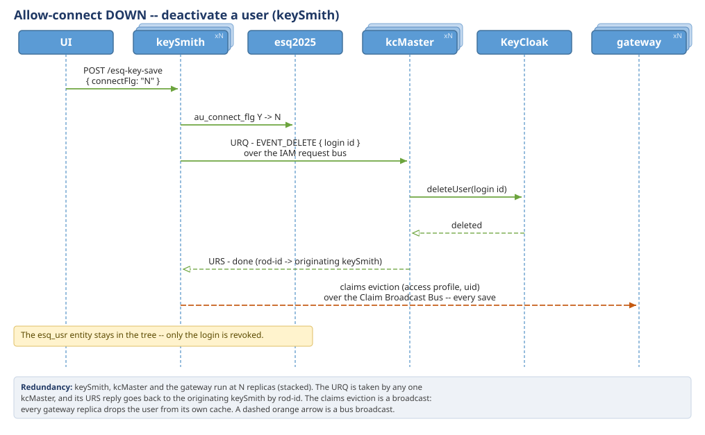
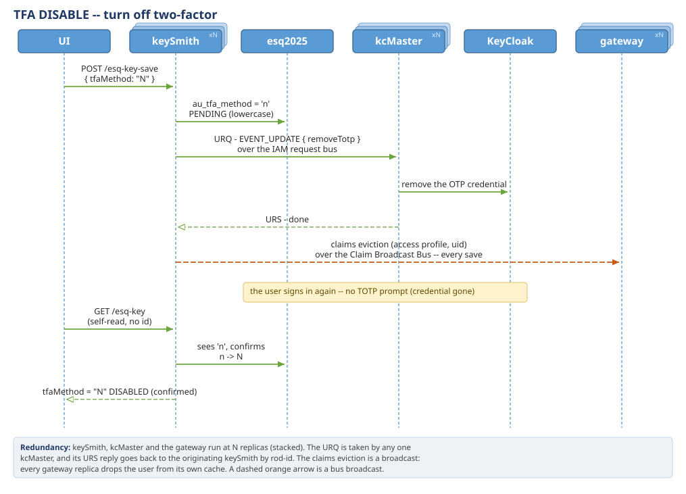

<table style="width: 100%; table-layout: fixed;">
  <tr>
    <td style="width: 12%"></td>
    <td style="width: 88%;">
       <h1>Esquire Application Frameworks(tm) 2.0</h1>
    </td>
  </tr>
</table>

# Esquire Authentication & Authorization — the tree-shaped security model

Esquire declares everywhere that **the tree is the authorization model** — the org chart and the access rules
are the same artifact, not two that drift apart. This document is how that actually works: who a caller is, what
they may see, and what they may do — resolved from **where they sit in the tree**, not from rules written
separately per feature.

Two members complete the **Esquire.Auth** suite:

- [`Esquire.Auth.TokenPatterns.md`](Esquire.Auth.TokenPatterns.md) -- the token formats and the edge patterns
  weighed for Esquire, and why the token carries the login id only.
- [`Esquire.Auth.keySmithRoutine.md`](Esquire.Auth.keySmithRoutine.md) — the credential-lifecycle state machines
  (reset password, TOTP, connection flag) keySmith runs with KeyCloak.

---

## 1. The idea

A caller signs in once, over **OAuth 2.0 / OIDC**, against KeyCloak (Section 3). The token KeyCloak issues says
who the caller is -- the **login id** -- and carries nothing else Esquire needs. Everything that defines
authorization stays in `esq2025`, where it is managed:

- **Claims define visibility.** The caller's entity **id** and **root path** fix *which slice of the tree* the
  caller can see (Section 4).
- **Roles define permissions.** The caller's roles fix *which operations* they may perform, per entity kind
  (Section 5).

**The gateway joins the two.** It validates the token locally, against KeyCloak's cached keys (JWKS), takes the
login id from it, and asks keySmith for that user's claims and roles. It keeps the answer in a cache and sends it
on with the request: as the `X-Esq-UID`, `X-Esq-Root-Path`, and `X-Esq-Roles` headers to a REST service, and as
fields of the command to a service on the bus. Each service reads the caller's identity and rights **from the
request itself**. There is no per-request call to KeyCloak, and no per-request database read in the services; the
gateway asks keySmith only when its cache does not hold the user.

A token holds nothing a reader could use to learn the caller's position or rights. Anyone who holds it can still
use it until it expires; the token is signed, not encrypted, and short-lived (five minutes on the shipped realm).

Two orthogonal dimensions, both read from the same tree: **position (the claims) → what you see; role → what you
do.** Traditional role-based access control answers only the second; Esquire makes visibility a first-class,
independent dimension — which is what *"the tree is the authorization model"* means in practice. A caller's
effective rights are the intersection: the role says *what* you may do; the path says *to which slice of the tree*
you may do it.

---

## 2. Identity -- the login id and the claims

The token names the caller; `esq2025` says what the caller is. Four values make up a caller:

| Value | Kept in | What it is |
|---|---|---|
| login id | `esq_auth.au_login_id`; the KeyCloak username | who signs in. The one Esquire value in the token (`preferred_username`). |
| uid | the `esq_usr` primary key | the caller's **entity id** -- unique across kinds, branches, and services. |
| root path | `esq_entity_path.ep_path` | the caller's **visibility root** -- the path of the subtree they belong to (Section 4). |
| roles | the access profile | what the caller may do (Section 5). |

**The gateway asks keySmith by login id.** The call is `GET /esq-claims?loginId=<login id>`, and the answer is
`EsqUserClaims(loginId, uid, rootPath, roles, changeNo)`. The endpoint is open on the service side and no gateway
route exposes it, so only a caller inside the cluster network can reach it. A failed lookup fails the
authentication: a login id with no access profile is refused, and a keySmith that does not answer gives a 503.

**The cache keeps an answer while it is used.** An entry not read for a minute (`esq.gateway.oauth.cache-idle-ms`,
default 60000) is dropped. A change to the user's claims drops it at once (Section 3.2), so the next request reads
the new values. Every gateway instance keeps its own cache.

Inside a service the values land in the per-request context, `EsqRequestContext`. The `JwtClaimsExtractionFilter`
reads them from the `X-Esq-*` headers. The gateway removes those headers from every inbound request before it sets
its own, so a client cannot send claims of its own choosing. The correlation and request ids are the tracing pair
(see `Esquire.ObservabilityStack.md`); `uid` and `rootPath` are the security pair.

**KeyCloak username = login id.** A user is looked up in KeyCloak by the login id, so the services never need the
KeyCloak user UUID. A user may also sign in with their email (`loginWithEmailAllowed`); the token then still names
them by login id.

---

## 3. The collaboration — keySmith / kcMaster / KeyCloak

Esquire never writes to KeyCloak from the business path. A change to a user's sign-in is **queued work handed to
a gateway**, so the entity change and the KeyCloak sync never block each other:

![The collaboration: keySmith writes the access profile and posts create, update and delete requests on the IAM request bus to kcMaster, the only KeyCloak writer, and gets a URS or a rejection back by rod-id. After every save keySmith, and for every moved user enyMan, broadcast a claims eviction on the Claim Broadcast Bus to every gateway replica. The gateway asks keySmith for the claims on a cache miss and passes the uid, root path and roles to the services as X-Esq-* headers or command fields. KeyCloak holds the login id, the email and the credential, and issues a token that carries the login id only.](img/auth-collaboration.svg)

- **keySmith** owns the access profile: it writes the `esq_auth` row (login id, email, connection flag,
  force-password-change, TOTP method) and the user's roles, and **posts** the matching identity command to the
  identity gateway. It never touches KeyCloak directly. After every save it also sends a claims eviction on the
  Claim Broadcast Bus (Section 3.2).
- **The identity gateway** (`IIdentityGateway`) is what keySmith holds instead of the provider. keySmith hands it
  the command and returns; how far the work then travels is the gateway's business. In the classic shape the
  gateway puts the command on the IAM bus. In the **compact** shape keySmith, enyMan, and kcMaster share one
  program, and the gateway calls the KeyCloak agent directly: the same command, the same single writer, no queue
  round trip. keySmith cannot tell which gateway it holds -- that is what the seam is for.
- **kcMaster** is the **only** service that writes to KeyCloak. It consumes the request, performs the create,
  update, or delete against KeyCloak, and replies. Because it is the single writer, KeyCloak state has one
  authority.
- **KeyCloak** is the identification host (below).

> **Everything here runs redundant.** keySmith and kcMaster each run at **N replicas** (in the compact shape, N
> replicas of the one program that holds both, with enyMan). A request (`URQ`) is taken by **one** kcMaster, and
> its reply goes back to the **originating** keySmith instance by rod-id. A claims eviction is a broadcast: it
> reaches **every** gateway instance, because each one keeps its own cache. The sequence diagrams below draw the
> services as stacked replicas.

### 3.1 KeyCloak — the identification host

KeyCloak is Esquire's **authentication authority**. Per user it holds the **login id** (the username), the
**email**, the **credentials** (the password hash, the TOTP / OTP credential), and the required actions (change the
password, set up TOTP). It holds **no Esquire data**: no entity id, no root path, no Esquire roles, and the realm
defines no Esquire roles. It runs the sign-in -- OIDC authorization-code + PKCE for the browser -- and, on success,
issues a signed JWT that names the user by login id. The Esquire services store **no password** and never
authenticate a user themselves; the gateway *validates* the KeyCloak-signed JWT locally against its cached JWKS.
Authentication is KeyCloak's; authorization (Sections 4-5) is Esquire's, from what keySmith answers.

### 3.2 Keeping esq2025 and KeyCloak in sync

The two stores hold two views of the same user, and **`esq2025` is the source of truth**:

- **`esq2025`** (the database) owns identity-as-*data* — who exists, their kind, their position (`ep_path`), their
  role, their access flags. This is where a change originates.
- **KeyCloak** mirrors only what sign-in needs -- the login id, the email, the credential, and the required
  actions. The claims and the roles stay in `esq2025`.

**Sign-in data flows one way, DB -> KeyCloak, always through kcMaster** (the single writer). When an access
profile is activated, changed, or deactivated, keySmith posts a request (`postRequest`). It travels as a `URQ` on
the KeyCloak request/response bus, and kcMaster applies it:

| Command | What kcMaster does in KeyCloak |
|---|---|
| create | a user with the login id as username, the email, the temporary password `changeit`, and the change-password action |
| update | renames the username when the login id changed; sets the email; adds or removes the change-password and TOTP actions; removes the OTP credential when TOTP is turned off |
| delete | removes the user, found by login id |

A request kcMaster cannot apply -- an update for a user KeyCloak does not have, for example -- is answered as a
failure (see *When a sync fails*).

**The claims are evicted, not copied.** Position and rights live only in `esq2025`, so a change to them needs no
KeyCloak write. What it needs is that every gateway stops using the values it cached. keySmith
sends a claims eviction on the Claim Broadcast Bus after every access-profile save, and enyMan sends one for every user a
move relocates. Every gateway instance drops that user from its cache, and the next request reads the new values
from keySmith. A role change or a move reaches a signed-in user on their next request, with no new sign-in.

A user's token stays valid through a move or a role change, because it names only the login id. KeyCloak holds no
path, so a move has nothing to send it.

### 3.3 Creating a user — two separate transactions

A user comes into being in **two independent steps, by two different services** — the entity first, the ability to
log in second:

1. **Create the user entry (enyMan).** enyMan writes the `esq_usr` row and its `esq_entity_path`. The user now
   **exists in the tree** — it has an id, a kind, a position, and can be seen and managed — but has **no way to log
   in**: the connection flag is `N`, and **no KeyCloak identity exists** yet.
2. **Activate the access profile (keySmith).** A separate operation flips the connection flag `N → Y`. keySmith
   writes the access columns and posts the identity command; kcMaster creates the KeyCloak user with the
   **login id and email**, a **temporary password `"changeit"`**, and a force-password-change action -- no roles
   and no claims. Only now can the user log in -- and on first login KeyCloak makes them replace `"changeit"` with
   a real password.

The connection flag is an **up / down switch on login ability**, run through keySmith (the
[credential state machine](Esquire.Auth.keySmithRoutine.md)): `N → Y` creates the KeyCloak identity (access
granted); `Y → N` deletes it (access revoked) while the `esq_usr` entity stays in the tree. So a user can exist
without access, be granted it, and have it taken away — **entity and login are decoupled** (deleting the entity is
even blocked while the connection is still `Y` — disable the login first).




> **esq2025 never stores a password.** The password — and the TOTP secret — live **only** in KeyCloak. esq2025
> holds the access *state* (the connection flag, the force-change flag, the TOTP method), but never the secret
> itself. `"changeit"` is a one-time bootstrap value KeyCloak forces the user to replace; it is kept nowhere in the
> Esquire database.

### 3.4 Credential changes — a ping-pong collaboration

A credential change is **not** a single request-response. Because the user completes the step **inside KeyCloak**
(at their next login), the change is written as **pending** first and **confirmed on a later self-read** — a
ping-pong across the **UI ↔ keySmith ↔ esq2025 / kcMaster ↔ KeyCloak** (keySmith owns the access-profile columns
like `au_tfa_method`; kcMaster is the only KeyCloak writer). Turning on **two-factor (TOTP)** is the clearest
example:


- **The request and the confirmation are two different round trips.** Between them the user must actually configure
  TOTP at KeyCloak, so keySmith cannot flip the flag active on the spot — it parks it **pending** (lowercase `g`)
  and promotes it (`g → G`) only when a later self-read proves KeyCloak accepted the setup. esq2025 carries the
  pending/active *state*; the OTP secret itself lives only in KeyCloak.
- **Disable is the mirror image.** `POST {tfaMethod:"N"}` parks `n`, kcMaster removes the OTP credential from
  KeyCloak, and the next self-read confirms `n → N`.


- **Password reset rides the same pattern** — `au_force_change_flg = Y` → KeyCloak's `UPDATE_PASSWORD` action →
  the flag clears on the next self-read once the user has changed it.

The exact flag values, validation rules, and the disable path are in
[`Esquire.Auth.keySmithRoutine.md`](Esquire.Auth.keySmithRoutine.md).

### 3.5 The enyMan side -- moves and the claims

keySmith owns the access profile (Sections 3.3-3.4). **enyMan** owns the entity side, and two of its operations
touch what a caller is:

**The login id and the email live on the access profile.** They are fields of the `esq_auth` row, which only
keySmith writes. A change to either is an access-profile save: keySmith writes the row, posts an update that
renames the KeyCloak user or sets its email (Section 3.2), and evicts the user's claims.


**A move changes the root path, and only in `esq2025`.** A move rewrites the whole subtree's `ep_path` in
`esq2025`, parents first (Section 4.3). KeyCloak holds no path, so enyMan sends it nothing. What enyMan sends is a
claims eviction for every user the move relocates, on the Claim Broadcast Bus. Each gateway drops that user from its cache,
and the user's next request reads the new root path from keySmith -- with the same token, and with no new
sign-in.


A user created while its subtree is being moved is handled on the tree side -- the move queue, parents-first
ordering, and the bizTree cache, in [`Esquire.BizTree.md`](Esquire.BizTree.md). KeyCloak takes no part in it,
because it holds nothing a move changes.

Replacing KeyCloak means replacing kcMaster with a service that speaks to a different IAM -- the rest of the
system is unchanged (the pluggable-IAM property; see [`Esquire.Vision.md`](Esquire.Vision.md)).

What the token carries, and why it is the login id only, is covered in
[`Esquire.Auth.TokenPatterns.md`](Esquire.Auth.TokenPatterns.md).

### When a sync fails

kcMaster answers every identity request: **URS** on success, **URR** on failure, carrying the error and the
request it was given. The requester records the answer, and kcMaster counts the outcome
(`esq.biz.kc.sync.total{outcome}`) and times it (`esq.biz.kc.sync.duration`), so a failed sync shows on the
board and in the log with its request and correlation ids.

Two stores can then disagree: `esq2025` holds the user and KeyCloak does not know it yet, or holds an older login
id or email. **`hauberk kc-reconcile`** finds that drift. It reads the truth from esq2025 over JDBC and the mirror
from KeyCloak over the REST admin API, talking to both directly rather than through the services, so it works
while they are down. It pairs the two sides by login id -- `esq_auth.au_login_id` against the KeyCloak username,
both in lower case -- and reports three kinds of drift, exiting 1 when it finds any:

| drift | meaning |
|---|---|
| `MISSING_IN_KC` | a connected Esquire user with no KeyCloak account |
| `ORPHAN_IN_KC` | a KeyCloak user whose username is no connected Esquire user's login id |
| `EMAIL_MISMATCH` | a paired user whose KeyCloak email is not `esq_auth.au_email` |

It repairs nothing: creating an account needs the credential and activation work that is kcMaster's, and a
deletion cannot be undone. A login id change that never reached KeyCloak shows as two rows, the new login MISSING
and the old one ORPHAN. An email mismatch matters because a user may sign in with the email: with the wrong one in
KeyCloak, the address Esquire shows them is refused at sign-in.

Tracking an answer back to the request that asked for it -- a reply timeout, a pending-request map,
replier-down detection -- is the messaging bus's continuing work, items 9 and 6 in
[`Herald.MessagingBus.ContinuingDev.md`](https://github.com/mir0n-pro/herald/blob/main/doc/Herald.MessagingBus.ContinuingDev.md).

---

## 4. Dimension 1 — hierarchical visibility (`ep_path`)

Visibility is structural: it is the `ep_path` of the `esq_entity_path` row. The caller's root path (Section 2) is
exactly this value. A read is scoped to the caller's subtree with a single prefix match --
`... WHERE ep_path LIKE :rootPath || '%'` — so a user sees their own branch, a regional manager sees their region,
and a root administrator (`ep_path` = `1.`) sees everything. **No per-query filter is written; the scope is the
path.** GET reads therefore need no explicit permission check — the `rootPath` already bounds what the query can
return.

**Adding your own read:** take `rootPath` as a parameter and keep the same prefix match,
`WHERE ep_path LIKE :rootPath || '%'`. For a write, find the entity through such a read first, then act on it
by id.

### 4.1 What `ep_path` holds, per entity type

`esq_entity_path` stores one row per entity; `ep_path` is a dot-separated hierarchical path string
(`1.9.200.`). Its meaning depends on the entity type and kind:

| Entity type | `ep_path` value | Example |
|---|---|---|
| **ORG** | the org's own full path — `parentOrgPath + orgPk + "."` | `1.9.200.` |
| **USR — admin (kind 30, 32)** | the parent org's path only — no user PK appended | `1.9.200.` |
| **USR — regular (kind 34, 36)** | the user's own full path — `parentOrgPath + usrPk + "."` | `1.9.200.100.` |
| **ACCT** | the owner user's `ep_path` — no account PK appended | `1.9.200.100.` |

- **ORG** — navigated hierarchically; the path includes its own PK so children scope via `LIKE '1.9.200.%'`.
- **Admin users (SYS_ADMIN / ADMIN, kind 30 / 32)** — their visibility root is their **org**. They see everything
  under it but do not form a subtree of their own, so the path is the org's path (no user PK).
- **Regular users (CLIENT / MERCHANT, kind 34 / 36)** — their visibility root is their **own node**; they own
  accounts beneath them, so the path is the org path + their own PK.
- **ACCT** — accounts belong to a user; their path equals the owner user's `ep_path`. No account PK is appended;
  an account is always scoped through its owner.

### 4.2 The parent-only rule — `isPathParentOnly()`

Whether an entity appends its own PK is one predicate on the kind:

```java
public boolean isPathParentOnly() {
    return id == 30 || id == 32;   // SYS_ADMIN and ADMIN
}
```

`true` means the entity's `ep_path` equals its parent's (no own PK). It drives both forming a path —

```java
String path = eek.isPathParentOnly() ? parentPath : parentPath + newId + ".";
```

— and reading the org PK back out of a user's path (admin: the last segment is the org PK; regular: the
second-to-last is).

### 4.3 Move semantics

A move re-parents a subtree; `ep_path` must be rewritten, and *how* depends on the parent-only rule:

- **Admin user** — several admins under one org share the same `ep_path`, so a move updates by **`ep_pk`** (not by
  path equality, which would hit all of them): `UPDATE esq_entity_path SET ep_path = :newPath WHERE ep_pk = :id`.
  Admins own no accounts, so no cascade is needed.
- **Regular user** — the path is unique (ends with the user's own PK), and the user's account rows share it, so a
  move updates by **path equality** in one statement, covering the user and all their accounts:
  `UPDATE esq_entity_path SET ep_path = :newPath WHERE ep_path = :oldPath`.

The org-move ordering (parents processed before children so a child's new path is built from its parent's
already-updated one) and the create-while-move race are the bizTree concern —
see [`Esquire.BizTree.md`](Esquire.BizTree.md).

### 4.4 The root path is `ep_path`, read when asked

The root path a service scopes its reads by (`rootPath` in the request context) is the caller's `ep_path`, as
keySmith reads it when the gateway asks. Nothing copies it anywhere else: it is not in the token and not in
KeyCloak. One value, one place. After a move the gateway drops the cached copy (Section 3.5), so the next request
scopes by the new path.

### 4.5 Where the path rules live

| Location | What |
|---|---|
| `enyMan / UsrService.createUsr()` | path computed via `isPathParentOnly()` |
| `enyMan / UsrService.moveUsr()` | admin: `moveAdminPath` by pk; regular: `moveUsrPaths` by equality |
| `enyMan / MoveQueueManager.evictClaims()` | after the move of a user, sends its claims eviction on the Claim Broadcast Bus |
| `bizTree / BizTreeCacheRepository.moveUsrNode()` | org PK extracted via `isPathParentOnly()` |
| `enyMan / AcctService.createAcct()` | account path fetched from the parent user's `ep_path` (`EsqAcctRepository.acctPath`) — account CREATE lives in enyMan; pacMan works only with existing accounts (read / update / delete + transactions) |

---

## 5. Dimension 2 — positional authority (roles)

Where visibility bounds *what a caller can reach*, roles bound *what a caller can do* (and what tools they see).

### 5.1 The enforcement points

- **GET reads — scoped by the path, no explicit permission check.** A read cannot return anything outside the
  caller's `rootPath` (Section 4), so position *is* the authorization for reads.
- **POST writes — gated by `EsqRolesStorage.isAdminCmdPermitted()`.** The gate runs ahead of any entity-level
  guard, and it is the one place the authorization decision is made (counted as `esq.biz.perm.check.total`, tagged
  allow / deny — the permission meter on the business dashboard).
- **Self-update bypass.** A caller acting on **their own** record (`id.equals(uid)`) passes the command gate
  without any admin role — editing yourself is not an admin authorization decision, which is why a regular user can
  maintain their own profile and credentials with no role at all. This is **not** carte blanche: *which* properties
  you may change on yourself is bounded field-by-field by the **`personal` flag** (5.3).

### 5.2 Role types — expandable with the domain

A role in Esquire is itself an **entity with a kind**, so the role system grows the same way any other entity
does. Four role / permission kinds exist; two are live, two are reserved for domain growth:

| Role kind | Code | Status | What it governs |
|---|---|---|---|
| **Admin** | 980 | live | what admin **functions** a holder may perform, **per entity kind** |
| **Tools** | 982 | live | tool-side / UI behavior — e.g. the **TREE** role that filters what the Esquire Explorer shows |
| **Applications** | 984 | reserved | (future) per-application access as the domain grows |
| **Reports** | 986 | reserved | (future) per-report access as the domain grows |

**Admin roles (980).** An admin role carries, **for each entity kind**, a small permission record — a flag per
admin command: `CREATE`, `UPDATE`, `DELETE`, `AUTH` (credential / connection operations), `ACCT` (account
operations). `"Y"` at a command's position permits it. So an admin role reads as a *function-per-kind* matrix —
e.g. *"for a MERCHANT (kind 36) this role may CREATE and UPDATE but not DELETE."* Esquire ships a **preset set of
admin roles**; `isAdminCmdPermitted` (5.1) is the gate that reads them. In storage this is
`Map<roleName, Map<entityKind, EsqPermission>>` — role, then entity kind, then the command flags.

The **preset admin roles** (seeded in `db.seed/.../fill/esq_role.sql`), each a function-per-kind matrix over the
demonstration kinds (org / admin / client / merchant / their accounts):

| Role | Held by | In short |
|---|---|---|
| **SYSADMIN** | system administrator (kind 30) | root authority — every function on every kind |
| **SUPERVIZOR** | office admin (kind 32) | full authority on the org subtree (org / admins / clients / merchants / accounts) |
| **MANAGER** | office admin | office manager — full authority for the office it runs |
| **OPERATOR** | office admin | limited — create / update client & merchant records; no deletes, no org / admin changes |
| **SUPPORT** | office admin | customer support — read / limited-update; no create or delete |
| **CLIENT** | client (kind 34) | the client's own scope — their own accounts / postings |
| **MERCHANT** | merchant (kind 36) | the merchant's own scope |

These describe the **demonstration** domain (a back-office of offices, admins, clients, merchants, accounts); a
real domain ships its own preset of the same shape (a role, a kind, the allowed functions).

**Tool roles (982).** These govern the **tools** a user sees, not the entity commands. The one in use is the
**TREE** role — seeded as *"Use of Esquire explorer api"* and attached across the admin / client / merchant kinds
— a **filter for the Esquire Explorer UI** that shapes what the tree presents to a given user. Tool roles are
deliberately **expandable**: the seed also carries a couple of placeholder tool roles, precisely because the kind
is meant to be filled per domain — a new tool role is just a new entity of kind 982, no framework change.

**Applications (984) / Reports (986) — reserved.** Declared but **not in use today**, held for domain expansion:
when a deployment grows per-application or per-report access, the role model already has the slots and the pattern
is the same (a role entity of the right kind carries the permissions), so the expansion needs no new mechanism.

Roles are held in an in-memory `EsqRolesStorage` (declared explicitly per service, per the no-`@Autowired` rule),
loaded from the seed. Role **exceptions** — a per-node override of a role's default permission — layer on top.

Together with Dimension 1: the role decides *whether* an operation is allowed and *what tools* appear; the path
decides *which entities* it can touch. A `DENY` at the gate, or an out-of-subtree target, stops the write.

### 5.2a One administrative role per user

A user holds **at most one admin role**. That is the model, not a convention: the gate resolves the caller's
permission matrix by finding the admin role among the caller's roles and reading its per-kind record, so one
role means one matrix and one answer. A user may hold tool roles (TREE) alongside it -- those govern what the
Explorer shows, not what a command may do.

The rule is enforced twice on the way in. The **UI refuses to offer it**: `esquire.ui.lib`'s tab-list
component will not add a second element of the admin role kind (980), so the Explorer -- and any application
built on the library -- cannot produce the case. Behind it the **server refuses to store it**: the roles
validator rejects a save that would leave a user with more than one administrative role. A user with two can
therefore only be made by a hand-built request, which is the same door every other trusted-parameter case goes
through.

There is **no database constraint** behind the rule, and that is deliberate. The user-to-role relation is
what changes next: `Esquire.Vision.md` names **hierarchical roles** as a backbone idea -- authority is
positional, a function of where you sit in the tree -- and today only the visibility half of that is built.
When a role becomes something a user holds **per branch** rather than once for the whole tree
(`Esquire.ContinuingDev.md` CD-19), a constraint written against today's shape would be written against the
shape that is going away.

### 5.3 Acting on yourself — the `personal` flag

Roles answer *what an admin may do to other people*. There is a separate, orthogonal question — *what a holder may
do to themselves* — and Esquire answers it **not** with roles but with a per-property **`personal`** marker.

Passing the self bypass (5.1) lets you edit your **own** record, but not every field on it. Each property in the
entity dictionary carries a **`personal`** flag (DB column `par_personal_flg`, dictionary element `<personal>` —
`Y` | `N`). When the caller is editing their own record (`personal = id.equals(uid)` is true), the validator
enforces it: a field **not** flagged `personal="Y"` is rejected with *"You cannot update the value by yourself."*
So self-service is a **whitelist of self-editable properties**, applied field-by-field:

| On your own record | Properties | Who may change them |
|---|---|---|
| **Personal (`Y`) — self-editable** | your contact / profile details (name, address, phone, email, company, title, ...) and your access-profile credential settings (**loginId, email, password-change request, TOTP method**) | you, yourself — no role needed |
| **Not personal — admin-only** | the structural / authority properties: your **roles**, your **path / position**, entity **kind**, the **connection** and **system** flags | only an admin acting under a role (5.1–5.2) |

The split is deliberate: you maintain your own particulars and credentials, but you cannot grant yourself a role,
move yourself in the tree, or flip your own connection state — those stay behind the role gate even on your own
record. When an admin edits **someone else** (`personal = false`), the `personal` flag does not apply at all; only
the role gate does.

---

## 6. Token flow at the edge

Everything above assumes a request reaches a service with the caller's claims on it. **The gateway is where that
is decided.** It validates the token's signature and expiry against KeyCloak's cached keys, takes the login id,
puts the claims from keySmith on the request, and strips any `X-Esq-*` header the client sent. A service behind it
does not check the token again: it reads the subject from the bearer and the claims from the headers, and trusts
both because only the gateway can have set them.

That trust has a cost. A request that reaches a service without passing the gateway is believed as sent -- the
network is that boundary, the same one that guards `/esq-claims`. Exposing a service port outside the cluster
removes the check.

How a browser holds its session (the BFF keeps the token on the server; the browser gets a cookie), what a direct
client does with its own token, and why the token carries the login id only, are the subject of
[`Esquire.Auth.TokenPatterns.md`](Esquire.Auth.TokenPatterns.md).

---

## The Esquire.Auth suite

- **This doc** -- the tree-shaped security model: the two dimensions, the login id and the claims, the
  keySmith / kcMaster / KeyCloak collaboration, and `ep_path` visibility semantics.
- [`Esquire.Auth.TokenPatterns.md`](Esquire.Auth.TokenPatterns.md) -- the token formats and the edge patterns
  weighed for Esquire, and why the token carries the login id only.
- [`Esquire.Auth.keySmithRoutine.md`](Esquire.Auth.keySmithRoutine.md) — the credential-lifecycle state machines
  (password / TOTP / connection flag).
